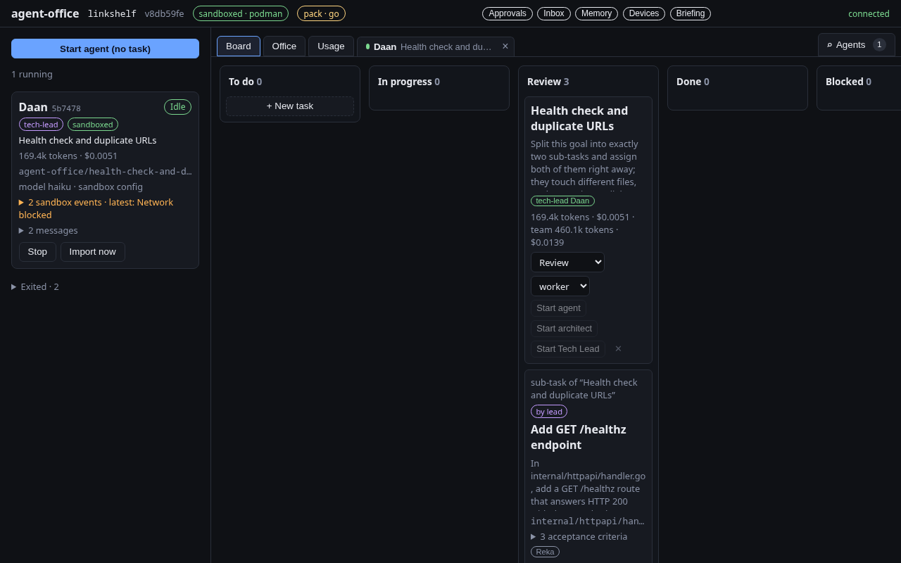
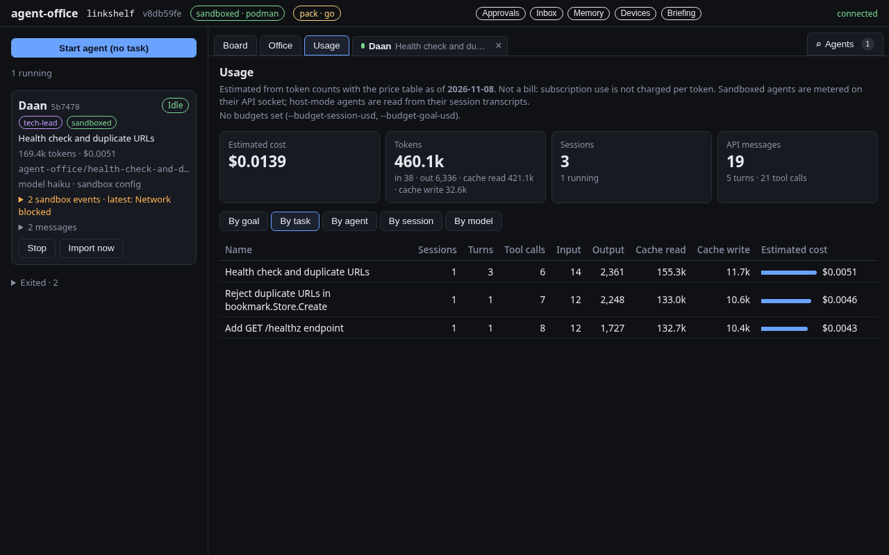
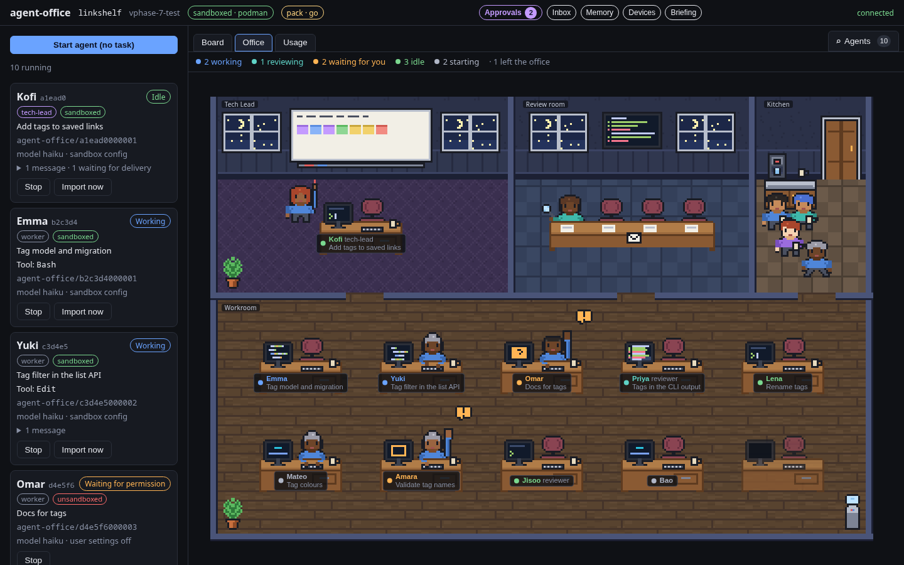
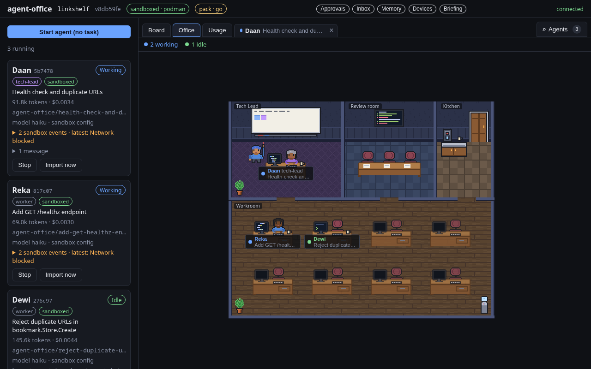
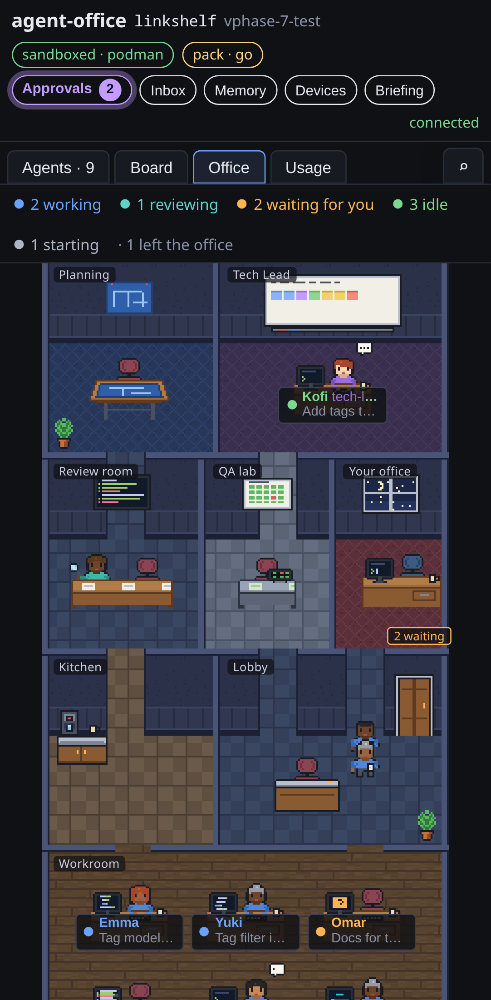
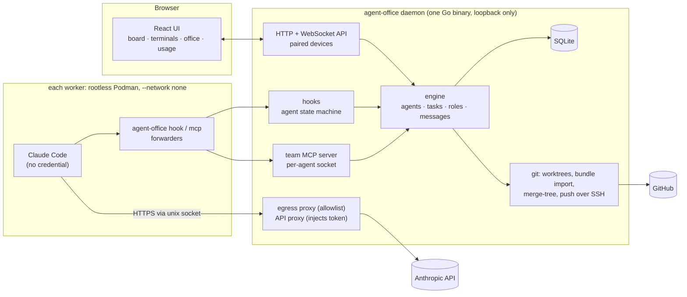

# agent-office

**Run a team of AI coding agents on your repository, safely, and watch them work.** You give
agent-office a goal. A Tech Lead agent splits it into sub-tasks and assigns them, and each worker
agent (Claude Code) runs in its own rootless Podman sandbox with its own git clone, no network
except an allowlist, and no access to your credentials. A local web UI shows the task board, every
agent's live terminal, token costs, and a pixel-art office where you can see who is working,
waiting for you, reporting at the Tech Lead's whiteboard or taking a coffee. Workers hand their commits back as verified git bundles. Pushing, opening pull
requests and anything risky stays behind deterministic checks and your approval. It is a single Go
binary with the UI embedded, Linux-first.


<sub>A real, unedited run at about 2× speed (`make demo`): a haiku Tech Lead and two sandboxed
haiku workers add two features to a small Go service in parallel, in 50 seconds, for under two
cents. The two sub-tasks touch different packages, so file ownership (ADR 0032) lets both run at
once.</sub>

## What it does

- **Team workflow.** An optional Architect agrees a plan with you. A Tech Lead assigns sub-tasks in
  dependency order, workers implement them, QA merges the branches and tests the result, and an
  Assistant briefs you. Roles are YAML files, so a new role needs no code
  ([docs/roles.md](docs/roles.md)).
- **Sandboxed workers.** Agents run with full permissions only inside a rootless Podman container
  with `--network none`. Egress goes through a per-agent allowlist proxy, and the API credential is
  injected outside the container. Stack packs choose the toolchain image, allowed hosts, secrets
  and skills ([docs/packs.md](docs/packs.md)).
- **Live terminals and state.** Every agent's PTY is streamed to xterm.js in the browser. Its state
  (working, waiting for you, idle) comes from Claude Code hooks. You can type into any session,
  approve access requests and answer questions from the inbox.
- **Guardrails in code, not prompts.** Dependencies and file ownership are enforced when tasks are
  assigned, and `git merge-tree` conflict checks run when work is reported. QA gates the goal,
  budgets are refused at the API socket, and pushes are flagged until you accept them. Merging is
  always yours.
- **GitHub loop.** Finished work becomes a pull request. A reviewer agent (or CodeRabbit) reviews
  it, and the original worker is relaunched to address the feedback.
- **Cost and history.** Token usage and estimated cost per goal, task, agent, session and model.
  Every session's terminal output is kept. Agents resume their conversations after a restart, and
  project memory reaches the agents it applies to ([docs/usage.md](docs/usage.md)).
- **From your phone.** An installable PWA over Tailscale, with every device paired by a one-time
  code ([docs/remote.md](docs/remote.md)).
- **An office you can watch.** A pixel-art floor plan with the Tech Lead's room, a review room, a
  kitchen and the workroom. Characters walk in through the front door, report at the whiteboard,
  review at the table, take a coffee when idle and leave when they are done, all derived from the
  same events as the board and drawn only when something moves
  ([ADR 0045](docs/adr/0045-office-floor-plan-and-errands.md)).

<p align="center">
  
  
</p>
<p align="center">
  
</p>
<p align="center">
  
  
</p>

## Architecture



The daemon supervises every agent CLI in a PTY. Agents talk back only through per-agent unix
sockets, so who is calling is never taken from a tool argument. Hook events drive the state
machine, and team tools (`create_task`, `assign_task`, `report_done`, …) go to an MCP server that
authorizes every call from the caller's recorded role. Work leaves the sandbox as a git bundle that
the daemon verifies and imports. The daemon, not the agent, pushes. The long form, with flows,
the domain model and the threat model, is in [docs/architecture.md](docs/architecture.md).

## Key design decisions

The decisions are recorded as 45 ADRs, indexed by topic in [docs/adr/](docs/adr/README.md).
The ones that shape the system most:

| Decision | Why | ADR |
|---|---|---|
| **Sandbox model:** rootless Podman per worker; permission prompts off only inside it | Agents need to run tools without asking every time, so the boundary has to be the container, not the agent's own permission prompts. Claude Code's built-in sandbox is at most an inner layer | [0007](docs/adr/0007-sandbox-approach.md) |
| **No network, token injection:** `--network none`; egress and the API only through per-agent unix sockets | The container holds a placeholder token. The daemon's API proxy forwards only `POST /v1/messages` and swaps in the real token, so an agent cannot leak a credential it never sees. Egress is CONNECT-only to allowlisted hosts; extra hosts need a human approval | [0016](docs/adr/0016-sandbox-network-and-api-injection.md), [0015](docs/adr/0015-agent-credential.md), [0019](docs/adr/0019-access-requests.md) |
| **Bundle hand-off:** each agent gets a clone with no remote; work comes back as a `git bundle` | The host never runs git inside an agent's repository, where hooks and config are attacker-controlled. Bundles are fsck-verified and must contain exactly the agent's branch. Imports never move a branch backwards, and commits are checked for identity before any push | [0014](docs/adr/0014-git-in-the-sandbox.md) |
| **Roles as data, authority from the socket** | Roles (prompt, model, tools, read-only or read-write workspace) are YAML over six behaviours whose maximum powers are code. What an agent may do depends on which socket it calls from, never on what it claims | [0029](docs/adr/0029-roles-as-data.md), [0017](docs/adr/0017-team-roles-and-authority.md) |
| **Deterministic gates around the model** | Dependencies, file overlap, conflicts, the QA gate, budgets and push gates are code. The model decides how to do the work, and code decides what it is allowed to do | [0032](docs/adr/0032-dependencies-and-conflicts.md), [0033](docs/adr/0033-qa-and-the-integration-branch.md), [0027](docs/adr/0027-budgets.md), [0020](docs/adr/0020-github-integration.md) |
| **State from hooks over a per-agent socket** | A forwarder (`agent-office hook`) relays Claude Code's hook events. The socket identifies the agent, and interrupts, which have no hook, are inferred from terminal input | [0003](docs/adr/0003-hook-ingestion.md), [0008](docs/adr/0008-interrupt-inference.md) |
| **Remote access without opening a port** | The daemon stays on loopback behind `tailscale serve`. Every request, local ones included, needs a paired device | [0038](docs/adr/0038-remote-access-tailscale-serve.md), [0039](docs/adr/0039-paired-devices.md) |

## Quick start (Linux)

You need git, make, Go 1.27+, Node 26+ (with npm), rootless
[Podman](https://podman.io/docs/installation) and [Claude Code](https://www.anthropic.com/claude-code),
logged in. Agents run with your Claude subscription. (On a minimal Debian, Node's official tarball
also needs `libatomic1`.) Checked from a fresh clone, on this machine and in a clean Debian
container.

```sh
git clone https://github.com/OzanAlpkaya/agent-office.git
cd agent-office
make build                                   # bin/agent-office, UI embedded

# Sandboxed agents authenticate with a long-lived token kept in a user-only file (ADR 0015).
install -d -m 0700 ~/.config/agent-office
claude setup-token                           # prints a token
(umask 077; cat > ~/.config/agent-office/oauth-token)   # paste it, Enter, then Ctrl-D

# Build the worker image once (needs network). --pack go adds the Go toolchain; without a pack
# you get the base image (git, curl, ripgrep, python3) and no language toolchain.
./bin/agent-office worker-image --pack go

./bin/agent-office serve --repo ~/src/some-go-project --pack go --model haiku
```

In a second terminal, pair your browser once:

```sh
./bin/agent-office pair                      # prints a one-time link: open it, click Pair
```

On the board, click **+ New task** and describe a small change. Then:

- **Start agent** runs one sandboxed worker on it. Watch its terminal. When the worker reports, the
  task moves to review and its branch, with its commits, appears in your repository
  (`agent-office/<task>-<id>`). The agent stays open for follow-up instructions until you stop it.
- For a team, write a goal, click **Start Tech Lead** and open the **Office** tab.

Agents' workspaces, the database and session logs live under `~/.local/share/agent-office`
(`--data-dir` to change it). Removing an agent never deletes uncommitted work. Every flag has an
`AGENT_OFFICE_*` variable ([.env.example](.env.example), `agent-office serve -h`). `--sandbox host`
runs agents directly on your machine with Claude Code's permission prompts on, for repositories
you trust.

## How this was built

agent-office was designed and directed by **Ozan Alpkaya** and implemented with
**[Claude Code](https://www.anthropic.com/claude-code)**. Ozan set the goals, the scope and the
order of the phases, answered the open questions, approved each phase's plan, reviewed every
decision, and tested each phase by hand. His findings became the next phase's backlog. Claude Code
wrote the code, tests and documentation within the rules in [CLAUDE.md](CLAUDE.md): plan first,
small commits, a test for every bug fix, and nothing merged without his approval.

The record of how it was built is in the repository:

- [docs/plan.md](docs/plan.md): the roadmap, with a Definition of Done per phase.
- [docs/plans/](docs/plans/): the approved plan of each phase, the answers to its open questions,
  and what changed while it ran.
- [docs/adr/](docs/adr/README.md): 42 decisions, each with its alternatives.
- [docs/architecture.md](docs/architecture.md): components, flows and the threat model, row by row
  with the tests that cover each mitigation.
- [PROGRESS.md](PROGRESS.md): the log of every phase and review.
- [spikes/](spikes/): the throwaway experiments that settled the risky parts first (PTYs, hook
  payloads, a network-less Claude Code).

Scale: about 26,000 lines of Go, 17,000 lines of Go tests (342 test functions) and 6,000 lines of
TypeScript. `make check` runs gofmt, vet, the web typecheck, `go test -race`, Vitest and the build.
Opt-in suites run real rootless Podman (`make sandbox-test`), Playwright against a mocked daemon
(`make ui-test`) and real Claude Code teams end to end (`make e2e`).

## More

- [docs/demo.md](docs/demo.md): recording the demo, and a script for showing it live.
- [docs/usage.md](docs/usage.md) cost and logs · [docs/roles.md](docs/roles.md) roles ·
  [docs/packs.md](docs/packs.md) stack packs · [docs/remote.md](docs/remote.md) phone access.
- **Limits:** Linux only. Claude Code is the only agent CLI so far (the adapter layer is built for
  more; Codex is researched in [docs/research/codex-cli.md](docs/research/codex-cli.md)).
  Single user, one goal at a time, pre-1.0.
- **Stack:** Go (`net/http`, `coder/websocket`, `creack/pty`, MCP Go SDK, SQLite via modernc + sqlc,
  go-github, `log/slog`); React, Vite, TypeScript, xterm.js and PixiJS for the UI.

## License

[MIT](LICENSE)
