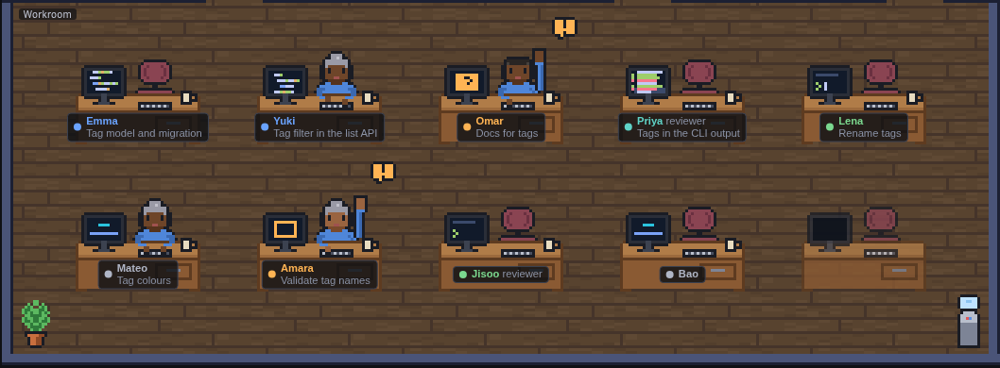

# agent-office

A local tool that runs a team of AI coding agents (Claude Code, Codex, ...) on a git repository.
A lead agent plans the work and assigns tasks; each worker agent gets its own git worktree and
sandbox; a web UI shows a task board, live terminals and, later, a pixel-art office where you can
watch the team at work.

> **Status:** in development; Phases 0–8 are done: sandboxed Claude Code agents (rootless Podman),
> a lead that plans and delegates through a team MCP server, a GitHub PR loop with code review,
> stack packs, a pixel-art office, and token usage, cost estimates and budgets
> ([docs/usage.md](docs/usage.md)). See [PROGRESS.md](PROGRESS.md).


<p align="center"></p>

## Quick start (Linux)

Requires Go 1.27+, Node 26+ and Claude Code on `PATH`.

```sh
make build
./bin/agent-office serve --repo ~/path/to/a/git/repo --model haiku
# open http://127.0.0.1:7680, add a task and click "Start agent"
```

Agents work in worktrees under `~/.local/share/agent-office/worktrees/`; removing an agent never
deletes uncommitted work. Trust the repository once in Claude Code; its worktrees inherit that.
Configuration flags and `AGENT_OFFICE_*` variables are listed in `.env.example` and
`agent-office serve -h`. `make check` runs lint, tests and the build; `make e2e` runs real Claude
Code sessions (opt-in, costs a few cents). The daemon only listens on loopback. Agents run on the host with Claude
Code's normal permission prompts. Sandboxed full-permission agents come in Phase 3.

## Planned features

- Live agent terminals in the browser (PTY → WebSocket → xterm.js)
- Agent state from Claude Code hooks (working, waiting for input, done)
- Multi-agent task board with one git worktree per worker
- Sandboxed workers (rootless Podman, egress allowlist, secrets as env vars)
- Team MCP server for coordination and a lead agent that delegates
- GitHub PR loop with pluggable code review
- Stack packs, cost tracking, memory, remote access over Tailscale

See the full roadmap in [docs/plan.md](docs/plan.md) and progress in [PROGRESS.md](PROGRESS.md).

## Stack

- **Daemon:** Go (`net/http`, `coder/websocket`, `creack/pty`, MCP Go SDK, SQLite + sqlc,
  go-github, `log/slog`). Shipped as a single binary.
- **UI:** React, Vite, TypeScript, xterm.js, PixiJS (office view), embedded into the binary.
- **Platform:** Linux first.

Architecture decisions are recorded in [docs/adr/](docs/adr/).

## Inspiration

Ideas inspired by [jsm-hq](https://github.com/jsmastery-pro/jsm-hq) and
[AgentSpace](https://muratify.com). No code, names or assets are reused.

## License

[MIT](LICENSE)
