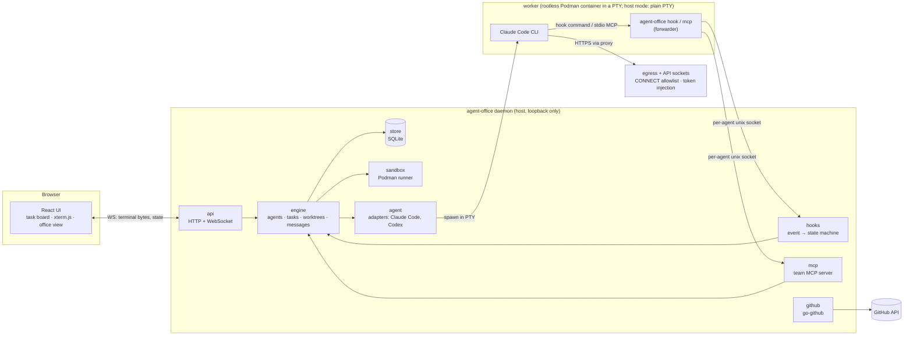
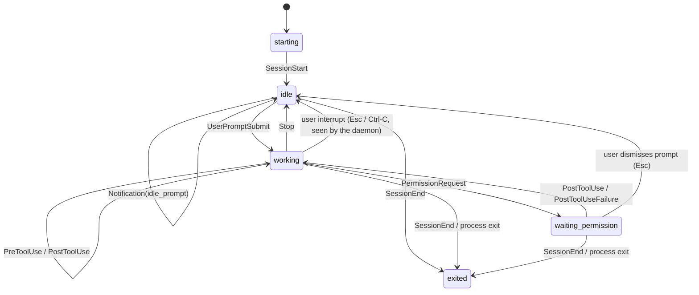

# Architecture

Status: Phase 0 design, updated through Phase 3 (isolation), based on the spikes in `spikes/` and
the ADRs in `docs/adr/`. Parts marked *(later)* belong to later phases and will be detailed then.

## Overview

agent-office is a single Go binary. Run as a daemon, it supervises agent CLIs (Claude Code first,
Codex later), each in its own PTY, git worktree and later its own rootless Podman container. A
browser UI talks to the daemon over HTTP and WebSocket. Agents talk to the daemon through hooks and
a team MCP server. Both go through one small forwarder, the same binary run as `agent-office hook`
or `agent-office mcp`, connected to a **per-agent unix socket**.

## Components (`internal/`)

| Package | Responsibility |
|---|---|
| `agent` | Adapter per agent CLI: command line, env, settings file, and translating CLI-specific hook payloads into common events. |
| `engine` | Owns the lifecycle of agents, tasks, worktrees and messages. All state changes go through it. |
| `hooks` | Accepts forwarded hook events from the per-agent sockets and runs the agent state machine. |
| `mcp` | Team MCP server (go-sdk): `create_task`, `assign_task`, `send_message`, `report_done`, `request_access`. *(Phase 4)* |
| `store` | SQLite via modernc + sqlc, forward-only goose migrations; refuses schemas newer than the binary and backs up before migrating (ADR 0004, 0011, 0012, 0013). |
| `git` | git CLI wrapper: worktrees, branches, branch-name slugs (ADR 0009, 0010). |
| `sandbox` | Starts workers in rootless Podman (`--network none`); per-agent egress proxy and credential-injecting API proxy; token file reader (ADR 0007, 0014–0016). |
| `github` | PRs and reviews through go-github; never the `gh` CLI. *(Phase 5)* |
| `api` | HTTP + WebSocket for the UI; serves the embedded UI build. |

## Key flows

**Start an agent (Phase 2).** The UI asks the API to start an agent, optionally for a task. The
engine reserves a slot (`--max-agents`), creates a git worktree on a new branch
(`agent-office/<task-slug>-<id>`) under `$XDG_DATA_HOME/agent-office/worktrees/<project>/<id>`
(ADR 0010), records agent, worktree and session in SQLite (ADR 0011), and moves the task to
`in_progress`. It then creates the agent's socket `$XDG_RUNTIME_DIR/agent-office/agents/<id>.sock`
(mode 0600) and a settings file whose hooks call `agent-office hook`, and spawns
`claude --session-id <uuid> --settings <file> --model <m> -- "<task prompt>"` in a PTY inside the
worktree. The child env is scrubbed of the daemon's own `CLAUDE*` variables, and
`AGENT_OFFICE_SOCKET` points at the agent's socket.

**Remove an agent.** Only exited agents can be removed. A clean worktree is removed, and its
branch is deleted unless it has commits. A dirty worktree is kept until the user explicitly
discards it. On startup the daemon marks unfinished agents `daemon_restart`, runs
`git worktree prune` and reconciles worktree records with the disk.

**Terminal.** The PTY reader goroutine appends output to a scrollback ring and fans it out to every
attached WebSocket (binary frames). Input and resize come back as JSON text frames. Sessions
outlive browser tabs; a re-attaching tab gets the scrollback followed by live output (ADR 0002).

**Agent state.** Claude Code runs `agent-office hook`, which forwards the stdin JSON over the
agent's socket and relays the daemon's reply to stdout. Which socket a connection arrives on
identifies the agent; the payload's `session_id` must match. The `hooks` package maps events to
states (ADR 0003):

Events that carry an `agent_id` (subagents, internal background agents) update activity details
but never the main state. Claude Code sends no hook for an interrupted turn or a dismissed
permission prompt, so the daemon, which carries all terminal input, treats a lone Esc or Ctrl-C
in those states as a user interrupt.

**Message delivery (Phase 4).** If the recipient is **working**, the message is queued and returned
as `{"decision":"block","reason":"<message>"}` on its next Stop hook (unless `stop_hook_active`).
If it is **idle**, the daemon types the message into the PTY as user input. Both paths were shown
to work in Spike B.

**Isolation (Phase 3).** Each sandboxed worker is a rootless Podman container with
`--network none`, a read-only rootfs and no capabilities (ADR 0007). It mounts its own shared
clone (the main repository's objects read-only), its per-agent sockets and the read-only
`agent-office` and versioned `claude` binaries. An init process bridges loopback ports to the egress
socket (CONNECT allowlist) and the API socket, where the daemon injects the OAuth token, so the
token never enters the container (ADR 0016). Work comes back as a bundle that the host verifies and
fetches; the host never runs git inside the agent's repository (ADR 0014). Agent repositories belong
to a subordinate uid (no `--userns=keep-id`), so git run by host tools (prompt, editor, file
manager) refuses to work there. **Do not `cd` into or open agent repositories; use the agent's
branch in the main repository.** Host mode (no sandbox,
permission prompts on) stays available as an explicit, labelled option.

**Import (Phase 3).** `Engine.Import` is the single entry point that brings a sandboxed agent's
branch into the main repository: on exit, on "Import now" (also while the agent runs), after a
daemon restart, before removal, and after "Save work". A helper container bundles the agent's
branch; the host verifies and fetches the bundle. An equal head changes nothing, a descendant
fast-forwards, and rewritten history goes to a new `<branch>-rewrite-N`, so an imported branch never
moves backwards. Every branch move is a compare-and-swap. Imported commits are checked for the
user's identity and the agent's `Co-Authored-By` trailer; mismatches are flagged, recorded and
shown. Removal imports first and removes nothing if that fails (ADR 0014).

**Sandbox events.** Proxy refusals (egress, API socket) and import problems become per-agent
events: logged, stored (rate-limited), pushed to the UI live and listed by
`GET /api/agents/{id}/events`, so a blocked request is visible instead of failing silently
(ADR 0016).

## Domain model (first draft)

| Entity | Key fields | Notes |
|---|---|---|
| **Agent** | id, name, role (lead / worker / reviewer), adapter (claude-code / codex), state, worktree_id, current_session_id | One live session at a time. |
| **Session** | id (= CLI session UUID), agent_id, started_at, ended_at, end_reason, transcript_path, cost_usd, tokens | One per CLI process; cost comes from the transcript (Phase 8). |
| **Task** | id, title, description, status (todo / assigned / in_progress / review / done / blocked), assignee_agent_id, created_by, parent_task_id | The lead creates tasks through MCP. |
| **Worktree** | id, repo_path, path, branch, base_ref, kind (worktree / clone), created_at, removed_at | One per worker agent; sandboxed agents get a shared clone (ADR 0014). |
| **Import** | id, agent_id, trigger, outcome, branch, head, previous, commits, flagged, at | One per import of a sandboxed agent's branch (migration 0003). |
| **Message** | id, from_agent_id, to_agent_id, body, created_at, delivered_at, delivery (stop_hook / pty) | Delivered exactly once. |
| **AccessRequest** | id, agent_id, kind (domain / secret / path), value, reason, status, decided_by | A human approves in the UI (Phase 4). |
| **Event** | id, agent_id, session_id, kind, at, summary | Hook events, reduced to non-sensitive fields. |

## Threat model (first draft, updated in Phase 3)

Phase 3 rows name the tests that check them. `make sandbox-test` runs against real rootless
Podman; `make e2e` runs real Claude Code.

**Assets:** the user's host (files, SSH keys, credentials), secrets given to agents (API keys,
GitHub token), repository integrity, and the user's account and money (API spend).

**Trust boundaries:** browser ↔ daemon, daemon ↔ agent process, agent ↔ internet, daemon ↔
GitHub. Agents are treated as **untrusted**: they run model-generated code and read
attacker-controllable content (issues, web pages, dependencies) that may carry prompt injection.

| Threat | Mitigation | Phase |
|---|---|---|
| A website drives the local daemon (CSRF / cross-site WebSocket) | Bind to loopback only; WebSocket same-origin check (tested in Spike A); later an auth token for the API | 1, 10 |
| Another local process forges hook events or MCP calls | Per-agent unix socket, mode 0600, in `$XDG_RUNTIME_DIR`; check `session_id` against the socket's agent | 1, 4 |
| Agent reads host secrets (`~/.ssh`, credential stores) | Container mounts only its own repository, the read-only object store and its sockets; env built from an allowlist (no `SSH_AUTH_SOCK`, tokens) (Spike F). Claude Code's own sandbox is not enough: reads are open by default and file tools are not covered (Spike E). Tested: `TestWorkerIsolation` (no host files beyond the mounts, read-only mounts refuse writes, no SSH or git credentials), `TestWorkerArgsIsolation` | 3 |
| Agent exfiltrates data over the network | `--network none`; per-agent CONNECT proxy, :443 and allowlisted names only, denials logged and shown (ADR 0016). Tested: `TestWorkerIsolation` (no DNS or direct TCP; other hosts, ports and plain HTTP refused), `TestWorkerEgress` (registries reachable, GitHub blocked). Residual: allowlisted registries (e.g. `proxy.golang.org` fetching arbitrary module paths) can carry data out | 3 |
| Secret leakage via the process list, `podman inspect`, disk or logs | Token in one user-only file, read by the daemon at each launch and injected by its API proxy; never `-e`, argv or `podman secret` (ADR 0015, 0016); `Secret` type redacts itself; never log env or hook payload contents; scrub `CLAUDE_CODE_*` from the child env. Tested: `TestSandboxedTokenStaysOutside` (a canary token reaches the upstream and nothing else: worker, `podman inspect`, terminal, updates, logs, DB, repositories) and `TestSandboxEndToEnd` (the real token, including Claude Code's transcripts) | 1, 3 |
| Agent exfiltrates its own credential | The token never enters the container: the daemon injects it on the API socket, which forwards only `POST /v1/messages` and logs and surfaces every rejected request (ADR 0016) | 3 |
| Agent-written git config runs on the host (`core.fsmonitor`, hooks) | The host never runs git inside an agent repository after start (enforced in `internal/git`); work comes back as a verified bundle fetched with `transfer.fsckObjects` (ADR 0014, Spike F) | 3 |
| Host tools (shell prompt, editor, file manager) run git in an agent repository and trigger agent-written config | Agent repositories are owned by a subordinate uid; git's `safe.directory` check refuses before reading their config (measured, ADR 0014). Residual: tools that offer to mark the repo safe, or read files without git; the UI and docs warn not to open agent repositories | 3 |
| Container escape (kernel or runtime bug) | Rootless Podman, a subordinate uid on the host, no capabilities, `no-new-privileges`, read-only rootfs. Residual: kernel and container-runtime vulnerabilities; keep the kernel and Podman updated | 3 |
| Agent exhausts host resources | Per-worker memory and pids limits (`--sandbox-memory`, `--sandbox-pids`); sandbox events rate-limited per agent; API request bodies size-limited | 3 |
| Agent spends inference without limit through the API socket | Budget limits on the API socket (deterministic, outside the model) | 4, 8 |
| Agent escalates its own permissions | `request_access` needs human approval; access changes are made by deterministic code, not the model | 4 |
| Runaway cost / loops | Stop-hook loop guard (`stop_hook_active`); per-agent budget and turn limits; cost tracking | 4, 8 |
| Malicious repo content runs on the host | Phases 1–2 run agents on the host with normal permission prompts (no bypass); full permissions only inside the sandbox | 1–3 |
| Agent pushes or merges unreviewed code | No git credentials or route to a remote in the sandbox (tested in Spike F); the daemon pushes from the main repository; imported commits are checked for author and trailer; merging stays human | 3, 5 |
| Sensitive data in captured payloads | Store reduced events only; raw hook payloads and transcripts are never persisted or sent to the UI in full | 1, 8 |
