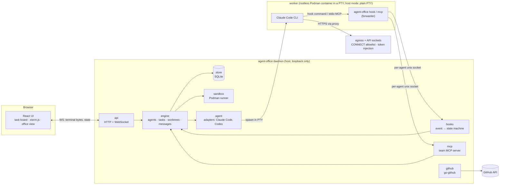
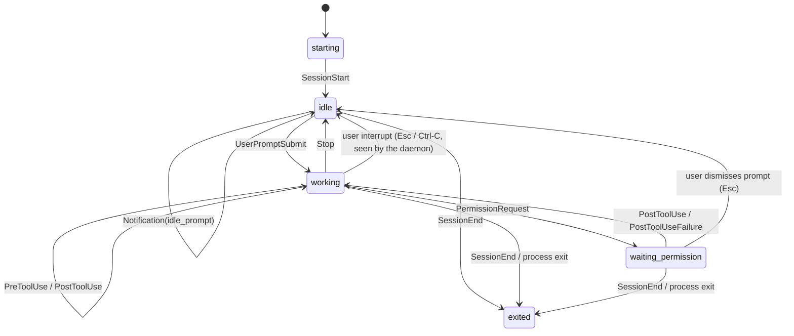

# Architecture

Status: Phase 0 design, updated through Phase 9 (memory and persistence; Phase 12 came before it), based on the spikes in `spikes/` and
the ADRs in `docs/adr/`. Parts marked *(later)* belong to later phases and will be detailed then.

## Overview

agent-office is a single Go binary. Run as a daemon, it supervises agent CLIs (Claude Code first,
Codex later), each in its own PTY, git worktree and later its own rootless Podman container. A
browser UI talks to the daemon over HTTP and WebSocket. Agents talk to the daemon through hooks and
a team MCP server. Both go through one small forwarder, the same binary run as `agent-office hook`
or `agent-office mcp`, connected to a **per-agent unix socket**.



## Components (`internal/`)

| Package | Responsibility |
|---|---|
| `agent` | Adapter per agent CLI: command line (also `--resume … --fork-session`, ADR 0035), env, settings file, and translating CLI-specific hook payloads into common events. |
| `engine` | Owns the lifecycle of agents, tasks, worktrees and messages. All state changes go through it. |
| `hooks` | Accepts forwarded hook events from the per-agent sockets and runs the agent state machine. |
| `mcp` | Team MCP server (go-sdk v1.8.0): `create_task`, `assign_task`, `list_tasks`, `send_message`, `report_done`, `request_access`, `submit_review` (reviewers), `report_no_change` (workers in a review follow-up), and from Phase 12 `message_user`, `submit_plan`, `start_qa`, `report_qa`, `get_briefing`, `list_memory`, `propose_memory`, over a `Team` interface the engine implements; each agent's server lists only its role's tools; per-agent socket listener; the `agent-office mcp` stdio bridge (ADR 0006). |
| `store` | SQLite via modernc + sqlc, forward-only goose migrations; refuses schemas newer than the binary and backs up before migrating (ADR 0004, 0011, 0012, 0013). |
| `git` | git CLI wrapper: worktrees, branches, branch-name slugs (ADR 0009, 0010); plumbing in the main repository: commits without a checkout, `merge-tree`, `commit-tree`, compare-and-swap branch moves, base fetches (ADR 0031, 0032). |
| `sandbox` | Starts workers in rootless Podman (`--network none`); per-agent egress proxy and credential-injecting API proxy; token file reader (ADR 0007, 0014–0016). |
| `github` | go-github v93 client for one repository: find-or-create PR, reviews, COMMENT reviews, checks; token file read per operation; no merge operation; `githubtest` fake for tests (ADR 0020). Never the `gh` CLI. |
| `review` | Pluggable `Reviewer` interface (`Request`, `Poll`) with the internal reviewer agent and CodeRabbit behind it; one `Feedback` shape (ADR 0021). |
| `secret` | Redacting `Secret` type and the user-only token-file reader (OAuth and GitHub tokens, ADR 0015, 0020). |
| `pack` | Stack packs (ADR 0023): strict YAML loader and validation, built-in `go` and `node` packs, user packs from a user-owned directory, build files for the pack image, skills, secret files. |
| `usage` | Token usage and cost (ADR 0026): transcript reader and API response meter (numbers and ids only), the price table (built in plus a user file; integer nano-USD). |
| `role` | Team roles (ADR 0029): strict YAML loader over six behaviours (architect, lead, worker, qa, reviewer, assistant), built-in roles and user roles from a user-owned directory, model overrides. |
| `api` | HTTP + WebSocket for the UI; serves the embedded UI build; request ids. |

## Key flows

**Start an agent (Phase 2).** The UI asks the API to start an agent, optionally for a task. The
engine reserves a slot (`--max-agents`), creates a git worktree on a new branch
(`agent-office/<task-slug>-<id>`) under `$XDG_DATA_HOME/agent-office/worktrees/<project>/<id>`
(ADR 0010), records agent, worktree and session in SQLite (ADR 0011), and moves the task to
`in_progress`. It then creates the agent's socket `$XDG_RUNTIME_DIR/agent-office/agents/<id>.sock`
(mode 0600) and a settings file whose hooks call `agent-office hook`, and spawns
`claude --session-id <uuid> --settings <file> --model <m> -- "<task prompt>"` in a PTY inside the
worktree. The child env is scrubbed of the daemon's own `CLAUDE*` variables, and
`AGENT_OFFICE_SOCKET` points at the agent's socket.

**Remove an agent.** Only exited agents can be removed. A clean worktree is removed, and its
branch is deleted unless it has commits. A dirty worktree is kept until the user explicitly
discards it. On startup the daemon marks unfinished agents `daemon_restart`, runs
`git worktree prune` and reconciles worktree records with the disk.

**Terminal.** The PTY reader goroutine appends output to a scrollback ring and fans it out to every
attached WebSocket (binary frames). Input and resize come back as JSON text frames. Sessions
outlive browser tabs; a re-attaching tab gets the scrollback followed by live output (ADR 0002).

**Agent state.** Claude Code runs `agent-office hook`, which forwards the stdin JSON over the
agent's socket and relays the daemon's reply to stdout. Which socket a connection arrives on
identifies the agent; the payload's `session_id` must match. The `hooks` package maps events to
states (ADR 0003):



Events that carry an `agent_id` (subagents, internal background agents) update activity details
but never the main state. Claude Code sends no hook for an interrupted turn or a dismissed
permission prompt, so the daemon, which carries all terminal input, treats a lone Esc or Ctrl-C
in those states as a user interrupt.

**Team (Phase 4, ADR 0017).** The user starts a **lead** on a top-level task, the goal (one lead at a
time). Every agent's CLI gets a `--mcp-config` file naming one stdio server, `agent-office mcp`,
which bridges stdio to the agent's own MCP socket (`mcp.sock`, mode 0600, next to its hook socket;
bind-mounted into sandboxed workers). The daemon serves one MCP server per agent on that socket, so
every tool call is attributed to the socket's agent, never to a tool argument (ADR 0006). The
engine authorizes each call from the caller's recorded role and task:

```mermaid
sequenceDiagram
  participant U as User (UI)
  participant L as Lead (Claude Code)
  participant D as Daemon (engine + MCP)
  participant W as Worker (Claude Code)
  U->>D: POST /api/agents {task_id: goal, role: lead}
  D->>L: start with the lead prompt
  L->>D: create_task × n (sub-tasks of the goal)
  L->>D: assign_task(sub-task)
  D->>W: Start (worktree or sandboxed clone, task to in_progress)
  L-->>D: Stop (turn ends, lead idle)
  W->>W: edit, test, commit
  W->>D: report_done(summary)
  D->>D: dirty check, import (sandbox), task to review
  D->>D: message to the lead (queued)
  D->>L: typed into the idle lead's terminal (or Stop-hook block)
  W-->>D: Stop → the worker is ended (slot freed)
  L->>D: report_done (no sub-task in progress) → goal to review; the lead stays (Phase 12)
```

- A lead may create up to 20 sub-tasks of its goal, assign those in `todo`/`blocked` (each
  assignment starts a worker through `Start`, within `--max-agents`), message their workers and
  list them. A worker may message only its lead, report only its own task (with committed work),
  and request access. `done` stays a human decision.
- Prompts: the lead is told to plan and delegate, not to edit code, and to end its turn after
  assigning; workers are told to commit, then call `report_done`. In host mode the team tools are
  pre-allowed (`mcp__agent-office` in the settings file); every other tool still prompts.

**Message delivery (Phase 4, ADR 0018).** Messages are rows in `messages`; delivery claims a
recipient's undelivered rows with one `UPDATE … RETURNING`, so each is handed out once.
- On the recipient's **Stop** hook (main agent, not `StopFailure`, not `stop_hook_active`), the
  reply is `{"decision":"block","reason":"<messages>"}`; the turn continues and the state stays
  `working`.
- When the recipient is **idle** (after a finished turn, an interrupt or `idle_prompt`), after a
  1.5 s settle delay, and only once it has finished its first turn and the user has not typed for
  5 s, the daemon types the messages into the PTY as **one line with every control character
  removed**, then Enter.
- Deliveries are framed as information from other agents, not instructions that override the
  recipient's task. Limits: 30 messages per sender per 10 minutes, 50 undelivered per sender and recipient,
  4 000 characters each.

**Access requests (Phase 4, ADR 0019).** `request_access(kind="domain", value, reason)` from a
sandboxed agent creates a `pending` row and nothing else. The UI's approval queue shows it; the
user allows or denies (`POST /api/access-requests/{id}/approve|deny`, decided once). An approval
adds the host to that running agent's egress grant set, checked by its egress proxy next to the
allowlist, until it exits. The agent gets a message with the decision. Pending requests expire when
their agent exits and at daemon start.

**GitHub loop (Phase 5, ADR 0020–0022).** Opt-in with `--github`. The repository comes from the
main repository's push remote; PRs target its default branch.

```mermaid
sequenceDiagram
  participant W as Worker
  participant D as Daemon
  participant G as GitHub
  participant R as Reviewer agent
  W->>D: report_done (branch imported, task to review)
  D->>D: identity check of the commits (flagged → wait for the user)
  D->>G: git push over SSH (main repository, never forced)
  D->>G: find-or-create PR (task title, neutralized body)
  D->>R: start on the PR head (own review branch, own slot)
  R->>D: submit_review(verdict, summary, comments)
  D->>G: COMMENT review on the reviewed commit
  D->>W: changes requested: relaunch in its workspace with the review in its prompt
  W->>D: commit, report_done → push (fast-forward) → same PR, next review
  Note over D,G: poll loop: PR state, checks, CodeRabbit and people's reviews; a human merge → task done
```

- The daemon is the only GitHub client: agents hold no GitHub token and cannot reach github.com.
  The token is read from a user-only file for every operation (ADR 0020).
- Reviewers (role `reviewer`) have only `list_tasks` and `submit_review`; the daemon validates the
  review and posts it as a `COMMENT` review. CodeRabbit is read by bot login and reviewed commit
  (ADR 0021).
- Actionable feedback (`changes_requested`) from the configured reviewer relaunches the original
  worker (a still-running one is ended first, once idle): same agent, workspace and branch, new
  session, the review quoted in its prompt; at most
  `--review-rounds` (default 2) automatic rounds per PR, then "Send to worker" by hand (ADR 0022).
  Messages are only delivered to the session they were queued for. In a follow-up round,
  `report_done` is refused until the branch has a new commit; a worker that finds no change needed
  calls `report_no_change(reason)`, which agent-office posts on the PR as a comment.
- Polling: every 30 s while a review or checks are pending, every 2 minutes otherwise; no webhooks
  (the daemon is loopback-only).
- `--github` needs sandboxed agents. Pushes wait for the user's acceptance of flagged commits and of
  any change under `.github/`. At most 10 automatic reviews per PR.

**Stack packs (Phase 6, ADR 0023).** `--pack <name>` picks one pack for the daemon run: a
built-in (`go`, `node`, embedded in the binary) or a directory in `~/.config/agent-office/packs`
that belongs to the user. Packs are never read from the repository. At startup the daemon
validates the pack, checks that its image exists and that its required secrets have files. Then,
for every sandboxed agent:

- **Image:** `localhost/agent-office-pack-<name>:<hash>`, built by `agent-office worker-image
  --pack <name>` from the pack's Containerfile `FROM` the base image; without a pack, the base
  image (no toolchain). The tag hashes every build input.
- **Egress:** the pack's hosts replace the default allowlist; `--egress-allow` adds to both.
- **Skills:** checked at load, written for each launch and mounted read-only at the agent's
  `CLAUDE_CONFIG_DIR/skills`.
- **MCP servers:** added to its `--mcp-config` next to `agent-office` (`--strict-mcp-config`).
- **Secrets** (workers only): read from user-only files at every launch and
  served **once** on a per-agent `secrets.sock`; `sandbox-init` puts them into the agent CLI's
  environment before starting it, so they never appear in argv or the container's config.

```mermaid
sequenceDiagram
  participant D as Daemon
  participant P as podman
  participant I as sandbox-init (container)
  participant C as Claude Code
  D->>D: read secret files (pack env names), write skills and MCP config
  D->>D: listen secrets.sock (one connection, then closed)
  D->>P: run pack image, mount secrets.sock (no secret in args or env)
  P->>I: start
  I->>D: connect secrets.sock
  D-->>I: {"env": {...}}; listener closed
  I->>C: exec with the secrets in its environment only
```

**Office view (Phase 7, ADR 0024, 0025).** The UI's Office tab draws the team as pixel-art
characters at desks, from the same `/api/events` stream as the board; the daemon is unchanged.

- Pure modules (`web/src/office/`): `pose` maps state and role to a pose (`starting` booting,
  `idle` leaning back, `working` typing or, for reviewers, reviewing, `waiting_permission` or a
  pending access request: hand raised, `exited` an empty chair); `layout` keeps every agent at
  the same desk while it exists (the lead at the front, by the whiteboard) and picks 3 to 6
  columns and a whole number of device pixels per world pixel for the pane; `model` adds the
  lead's sub-tasks as whiteboard notes and finds new messages to animate.
- The PixiJS 8 scene (WebGL, canvas fallback) is lazy-loaded with the tab and destroyed when it
  closes; it draws only frames that changed, at most 30 a second, and honours
  `prefers-reduced-motion`. Desk assignments last for the page, so switching tabs moves nobody.
  All art is drawn in code (`web/src/office/ART.md`).
- Names and task titles are HTML nameplates over the canvas, positioned from the same layout;
  clicking a character or a nameplate opens that agent's terminal, the scene's only action.
- Tests: Vitest for the pure modules (`make check`); Playwright against a mocked daemon
  (`make ui-test`), including clicks on the canvas and the frame rate with 10 and 20 agents.

**Usage, cost and logs (Phase 8, ADR 0026–0028).** One row per API message (`usage_messages`),
priced when read, so a price change re-prices history; money is integer (nano-USD inside, micro-USD
in the API).

```mermaid
flowchart LR
  subgraph Sandboxed
    CC1[Claude Code] -- POST /v1/messages --> AS[API socket proxy]
  end
  AS -- budget check --> ENG[engine]
  AS -- stream passes through, meter reads usage --> ENG
  subgraph Host mode
    CC2[Claude Code] -- writes --> TR[(transcript .jsonl<br/>+ subagent files)]
    CC2 -- hooks carry transcript_path --> ENG
  end
  ENG -- reads new lines after turns --> TR
  ENG --> DB[(usage_messages, sessions counters)]
  ENG -- live "usage" updates --> UI[Usage tab, cards]
  DB -- GET /api/usage, priced on read --> UI
```

- Sandboxed: the API proxy wraps each successful response in a meter that reads `message_start` /
  `message_delta` usage as the bytes pass (no buffering); the client's `Accept-Encoding` is dropped
  so the meter sees plain text. Before forwarding, the engine checks the optional session and goal
  budgets (ADR 0027) and refuses with a 403 once one is spent.
- Host mode: the transcript path from the hooks is validated (`<session-id>.jsonl`, a regular file of
  the user, no symlink) and read incrementally; Claude Code's own `cost-state` figure is kept next
  to agent-office's estimate.
- Logs: every record naming an agent gets its `session_id` and `task_id` (a wrapping `slog` handler
  plus per-session loggers), so one `jq` filter follows a session through hooks, team tool calls,
  API requests (with Anthropic's `request-id`), delivery and imports. `--log-format json`.
- Retention: events older than 30 days are deleted daily; the newest 3 migration backups are kept.

**Team workflow (Phase 12, ADR 0029–0034).** Roles are data over six behaviours the engine
implements (`docs/roles.md`): a role brings the prompt, model (`--role-model`), a subset of its
behaviour's team tools, denied Claude Code tools (`permissions.deny`) and a read-only or read-write
workspace (`:ro` mount in the sandbox); authorization uses the agent's **kind** (behaviour), never
its role name. A goal runs like this:

```mermaid
sequenceDiagram
  participant U as User (UI)
  participant A as Architect (read-only)
  participant D as Daemon
  participant L as Tech Lead (read-only)
  participant W as Workers
  participant Q as QA
  U->>D: Start architect on the goal
  A->>U: message_user(question) → inbox; the answer comes back as the user's words
  A->>D: submit_plan(design, sub-tasks, depends_on, files, acceptance)
  D->>U: plan version shown on the goal card (edit = new version)
  U->>D: Approve
  D->>D: commit docs/specs/<goal>.md on agent-office/spec-<slug>-<goal> (plumbing), create sub-tasks
  D->>A: end (plan_approved); start the Tech Lead with the plan
  L->>D: assign_task (refused: unmet dependencies, overlapping files of a running sub-task)
  D->>W: start from the dependencies' work (merge-tree + commit-tree for several), else the spec commit
  W->>D: report_done → merge-tree vs. the base and the other open sub-tasks → conflicts on the tasks, to the lead
  L->>D: start_qa (no sub-task in progress)
  D->>Q: own clone at the goal's base with every reported branch
  Q->>D: report_qa(pass | fail, bugs) → bugs become sub-tasks
  L->>D: report_done → refused unless QA passed on the current heads and no bug sub-task is open
  L-->>U: stays idle for follow-up work; marking the goal done ends it
  L->>D: send_message(to="architect") when the plan breaks → the architect is relaunched with the spec
```

- **Escalation chain:** worker → Tech Lead → architect → user. `message_user` is for agents with
  nobody above them (architect, assistant, a lead without an architect, a worker without a running
  lead); the others are told whom to ask. Messages to the user are inbox items (30 per agent per
  10 minutes, 20 unread), shown in the header's Inbox and on the task card; replies are delivered
  like team messages, framed as the user's own words (ADR 0030).
- **Conflicts** (ADR 0032): order and file ownership are enforced by `assign_task`; `merge-tree`
  checks run in the main repository on every report and after a PR merges on GitHub (base fetched,
  other open PRs re-checked); a conflicting worker is relaunched to merge the new base (2 automatic
  rounds per PR, a ref set in sandboxed repositories by a helper container), or by hand with
  **Resolve conflict**.
- **Assistant** (ADR 0034): no task, read-only, one at a time; `get_briefing` returns facts the
  daemon computes (goals, what waits on the user, what is blocked, running agents, cost); it
  proposes project memory, which reaches every agent's first prompt only after the user accepts it.
- `--max-agents` still counts every running agent; an idle Tech Lead or assistant keeps its slot.

**Memory and persistence (Phase 9, ADR 0035–0037).**

```mermaid
sequenceDiagram
  participant D1 as Daemon (run 1)
  participant DB as SQLite + data dir
  participant D2 as Daemon (run 2)
  participant C as Claude Code
  D1->>DB: every 5 s and at exit: scrollback -> terminals/<project>/<agent>/<session>.log
  D1->>DB: stop (shutdown) or crash: agents.resume_state = what each agent was doing
  D2->>DB: reconcile, restart imports (sandbox), GitHub restart rules
  D2->>C: claude --resume <last session> --fork-session --session-id <new> [-- restart prompt]
  C-->>D2: SessionStart (source fork, the new id) -> queued messages delivered
  D2->>DB: sessions.resumed_from; resume_state cleared; inbox notice (restored / not, why)
```

- **Resume** (ADR 0035): an exited worker, architect, lead or assistant continues its latest
  conversation in its workspace and sandbox (Resume button, `POST /api/agents/{id}/resume`), with an
  optional prompt; same agent, new session (`resumed_from`), fresh session budget, task status
  unchanged, messages queued for the conversation delivered. QA and reviewers are not resumed.
  Relaunches for reviews, conflicts and escalations stay fresh sessions (ADR 0022).
- **Restore** (`--restore-agents`, default on): at start, agents the previous stop interrupted are
  resumed once (coordinators first, within `--max-agents`); mid-turn ones get agent-office's
  "you were cut off" prompt, idle ones none. Agents in a review round, still starting, of the other
  sandbox mode or beyond the slots stay exited and are listed in the notice.
- **Host usage of forks:** a forked transcript repeats its parent's messages and its cost-state is
  cumulative; the reader skips known message ids and subtracts the chain's CLI cost.
- **Session history** (ADR 0036): every session's scrollback is saved (0600, data dir); `GET
  /api/agents/{id}/sessions` and `…/sessions/{sid}/terminal`; the UI replays it read-only with a
  session picker. Deleted with the agent and by event retention.
- **Relevant memory** (ADR 0037): entries may be scoped to role names and file patterns; a first
  prompt lists the entries that apply to the agent's role and its task's declared files, scoped
  ones first, within 6 000 characters; `list_memory` (all behaviours but reviewers) shows every
  accepted entry marked `applies_to_you`; `GET /api/memory/export` downloads Markdown.

**Isolation (Phase 3).** Each sandboxed worker is a rootless Podman container with
`--network none`, a read-only rootfs and no capabilities (ADR 0007). It mounts its own shared
clone (the main repository's objects read-only), its per-agent sockets and the read-only
`agent-office` and versioned `claude` binaries. An init process bridges loopback ports to the egress
socket (CONNECT allowlist) and the API socket, where the daemon injects the OAuth token, so the
token never enters the container (ADR 0016). Work comes back as a bundle that the host verifies and
fetches; the host never runs git inside the agent's repository (ADR 0014). Agent repositories belong
to a subordinate uid (no `--userns=keep-id`), so git run by host tools (prompt, editor, file
manager) refuses to work there. **Do not `cd` into or open agent repositories; use the agent's
branch in the main repository.** Host mode (no sandbox,
permission prompts on) stays available as an explicit, labelled option.

**Import (Phase 3).** `Engine.Import` is the single entry point that brings a sandboxed agent's
branch into the main repository: on exit, on "Import now" (also while the agent runs), after a
daemon restart, before removal, and after "Save work". A helper container bundles the agent's
branch; the host verifies and fetches the bundle. An equal head changes nothing, a descendant
fast-forwards, and rewritten history goes to a new `<branch>-rewrite-N`, so an imported branch never
moves backwards. Every branch move is a compare-and-swap. Imported commits are checked for the
user's identity and the agent's `Co-Authored-By` trailer; mismatches are flagged, recorded and
shown. Removal imports first and removes nothing if that fails (ADR 0014).

**Sandbox events.** Proxy refusals (egress, API socket) and import problems become per-agent
events: logged, stored (rate-limited), pushed to the UI live and listed by
`GET /api/agents/{id}/events`, so a blocked request is visible instead of failing silently
(ADR 0016).

## Domain model (first draft)

| Entity | Key fields | Notes |
|---|---|---|
| **Agent** | id, kind (architect / lead / worker / qa / reviewer / assistant), role (the role's name), model, sandbox, state, task_id, current_session_id | One live session at a time; at most one running lead, architect, QA and assistant (ADR 0017, 0029); workers and architects can be relaunched in their workspace with a new session (ADR 0022, 0031); workers, architects, leads and assistants can be resumed with their conversation, and are restored after a restart from `resume_state` (ADR 0035). |
| **Session** | id (= CLI session UUID), agent_id, started_at, ended_at, turns, tool_calls, cli_cost_micro_usd, resumed_from | One per CLI process; the correlation id of its logs (ADR 0028); a resumed one names the session whose conversation it continues; its terminal output is saved in the data dir (ADR 0035, 0036). |
| **UsageMessage** | session_id, message_id, agent_id, task_id, source (api / transcript), request_id, model, speed, inference_geo, input / output / cache read / cache write 5m / 1h tokens | One per API message, upserted; priced when read (ADR 0026). |
| **Task** | id, title, description, status (todo / in_progress / review / done / blocked), parent_task_id, created_by, depends_on, files, acceptance, role, spec_key, conflicts | A goal is a top-level task; its sub-tasks come from an approved spec or the lead's `create_task`. Agents point to their task (`agents.task_id`). |
| **Spec** | id, goal_id, version, status (proposed / approved / superseded), author, plan (JSON), markdown, branch, commit, path | One row per version of a goal's plan; approval commits it (ADR 0031). |
| **QARun** | id, goal_id, agent_id, status (running / passed / failed / error), branch, head, merged (task, branch, head), summary, bugs | One per `start_qa`; the latest gates the goal's report (ADR 0033). |
| **InboxItem** | id, agent_id (empty: agent-office), task_id, goal_id, role, kind (question / blocked / info / briefing / plan), body, read_at, answered_at, reply | A message to the user (ADR 0030). |
| **MemoryEntry** | id, kind (decision / convention / lesson), title, body, status (proposed / accepted), source, roles, paths | Accepted entries reach the prompts of the agents their scope includes (ADR 0034, 0037). |
| **Worktree** | id, repo_path, path, branch, base_ref, kind (worktree / clone), created_at, removed_at | One per worker agent; sandboxed agents get a shared clone (ADR 0014). |
| **Import** | id, agent_id, trigger, outcome, branch, head, previous, commits, flagged, at | One per import of a sandboxed agent's branch (migration 0003). |
| **Message** | id, from_agent_id (empty: agent-office), to_agent_id, body, created_at, delivered_at, delivery (stop_hook / pty) | Claimed once, then delivered (ADR 0018). |
| **AccessRequest** | id, agent_id, kind (domain; secret / path reserved), value, reason, status (pending / approved / denied / expired), decided_at, decided_by | A human decides in the UI; a grant lasts for that agent's run (ADR 0019). |
| **PullRequest** | id, task_id, agent_id (the worker), branch, base, number, url, state (pending / open / merged / closed), head, checks, pending / accepted flagged commits, rounds, error | One per pushed branch (migration 0005, ADR 0020). |
| **Review** | id, pr_id, reviewer (internal / coderabbit / human), head, status (queued / running / done / failed / timed_out), verdict, summary, comments, agent_id, github_review_id, followup, reply, reply_url | One per reviewed head; people's reviews are recorded, never acted on automatically (ADR 0021, 0022). |
| **Event** | id, agent_id, session_id, kind, at, summary | Hook events, reduced to non-sensitive fields. |

## Threat model (first draft, updated in Phases 3 and 4)

Phase 3 and 4 rows name the tests that check them. `make sandbox-test` runs against real rootless
Podman; `make e2e` runs real Claude Code.

**Assets:** the user's host (files, SSH keys, credentials), secrets given to agents (API keys,
GitHub token), repository integrity, and the user's account and money (API spend).

**Trust boundaries:** browser ↔ daemon, daemon ↔ agent process, agent ↔ internet, daemon ↔
GitHub. Agents are treated as **untrusted**: they run model-generated code and read
attacker-controllable content (issues, web pages, dependencies) that may carry prompt injection.

| Threat | Mitigation | Phase |
|---|---|---|
| A website drives the local daemon (CSRF / cross-site WebSocket) | Bind to loopback only; WebSocket same-origin check (tested in Spike A); later an auth token for the API | 1, 10 |
| Another local process forges hook events or MCP calls | Per-agent unix sockets (hooks, MCP), mode 0600, in a 0700 dir under `$XDG_RUNTIME_DIR`; hooks: `session_id` checked against the socket's agent; MCP: one server per agent bound to its socket, the caller never comes from arguments. Tested: `TestListenerIdentity`, `TestMCPOverAgentSocket`, `TestSandboxedTeamWorker` (through the in-container bridge). Residual: any process of the same user can reach the sockets (same as hooks) | 1, 4 |
| Agent reads host secrets (`~/.ssh`, credential stores) | Container mounts only its own repository, the read-only object store and its sockets; env built from an allowlist (no `SSH_AUTH_SOCK`, tokens) (Spike F). Claude Code's own sandbox is not enough: reads are open by default and file tools are not covered (Spike E). Tested: `TestWorkerIsolation` (no host files beyond the mounts, read-only mounts refuse writes, no SSH or git credentials), `TestWorkerArgsIsolation` | 3 |
| Agent exfiltrates data over the network | `--network none`; per-agent CONNECT proxy, :443 and allowlisted names only, denials logged and shown (ADR 0016). Tested: `TestWorkerIsolation` (no DNS or direct TCP; other hosts, ports and plain HTTP refused), `TestWorkerEgress` (registries reachable, GitHub blocked). Residual: allowlisted registries (e.g. `proxy.golang.org` fetching arbitrary module paths) can carry data out | 3 |
| Secret leakage via the process list, `podman inspect`, disk or logs | Token in one user-only file, read by the daemon at each launch and injected by its API proxy; never `-e`, argv or `podman secret` (ADR 0015, 0016); `Secret` type redacts itself; never log env or hook payload contents; scrub `CLAUDE_CODE_*` from the child env. Tested: `TestSandboxedTokenStaysOutside` (a canary token reaches the upstream and nothing else: worker, `podman inspect`, terminal, updates, logs, DB, repositories) and `TestSandboxEndToEnd` (the real token, including Claude Code's transcripts) | 1, 3 |
| Agent exfiltrates its own credential | The token never enters the container: the daemon injects it on the API socket, which forwards only `POST /v1/messages` and logs and surfaces every rejected request (ADR 0016) | 3 |
| Agent-written git config runs on the host (`core.fsmonitor`, hooks) | The host never runs git inside an agent repository after start (enforced in `internal/git`); work comes back as a verified bundle fetched with `transfer.fsckObjects` (ADR 0014, Spike F) | 3 |
| Host tools (shell prompt, editor, file manager) run git in an agent repository and trigger agent-written config | Agent repositories are owned by a subordinate uid; git's `safe.directory` check refuses before reading their config (measured, ADR 0014). Residual: tools that offer to mark the repo safe, or read files without git; the UI and docs warn not to open agent repositories | 3 |
| Container escape (kernel or runtime bug) | Rootless Podman, a subordinate uid on the host, no capabilities, `no-new-privileges`, read-only rootfs. Residual: kernel and container-runtime vulnerabilities; keep the kernel and Podman updated | 3 |
| Agent exhausts host resources | Per-worker memory and pids limits (`--sandbox-memory`, `--sandbox-pids`); sandbox events rate-limited per agent; API request bodies size-limited | 3 |
| Agent spends inference without limit through the API socket | Phase 4 bounds the number of sessions (below); optional budgets per session and per goal in estimated USD, refused on the API socket by deterministic code, failing closed for unpriced models (ADR 0027). Tested: `TestBudgets`, `TestAPIProxyMetersUsageAndBudget`. Residual: off by default; requests in flight finish; host-mode agents are not limited; estimates follow the price table | 4, 8 |
| Agent escalates its own permissions | `request_access` only creates a pending row; a human decides in the UI (same-origin POST); the grant is made by the engine, for that agent's run only, domains only (ADR 0019). Tested: `TestAccessRequests` (no grant before approval, grant reaches this agent only, decided once, expiry on exit), `TestRestartExpiresAccessRequests`, `TestAccessRequestsAPI`, `TestEgressGrants`. Team authority comes from the caller's socket and role (ADR 0017); `TestTeamAuthorization`, `TestToolsPerRole` | 4 |
| A prompt-injected lead spawns workers or floods the team | Lead authority is limited to its goal: 20 sub-tasks, assignments only within `--max-agents`, no human-free path to anything else; reported workers end and free their slot. Tested: `TestTeamLimits`, `TestAssignTaskIsExclusive` | 4 |
| Runaway cost / loops (agents keep each other busy) | Stop-hook loop guard (`stop_hook_active`: no delivery on that Stop); 30 messages per sender per 10 minutes, 50 undelivered per sender and recipient (report notices and agent-office's own messages are exempt, so a flood cannot block them); messages to agents that reported are refused; a goal budget bounds a whole team in money (ADR 0027), and the Usage tab shows the spend live. Residual: within those limits (and with budgets off) two agents can keep answering each other. Tested: `TestStopHookDeliveryExactlyOnce`, `TestTeamLimits`, `TestQueueCapIsPerSender` | 4, 8 |
| Prompt injection between agents (a compromised agent's message steers another) | Messages are framed as information from other agents, not instructions, with every body line quoted so it cannot forge a header (`TestQueueCapIsPerSender`); workers can reach only their lead and the lead only its workers; the recipient's own task and authorization are unchanged by any message. Residual: the recipient model may still follow a persuasive message within its own permissions | 4 |
| Terminal injection through message delivery (escape sequences, Esc / Ctrl-C typed into another agent's PTY) | Stored bodies lose control characters except newline and tab; the PTY line loses all of them; delivery goes through the engine's input path (ADR 0008, 0018). Tested: `TestIdleDeliveryOverPTY`, `TestPTYLine` | 4 |
| Agent-written text in the UI (messages, access reasons, task titles, tool names) | Rendered as text by React, never as HTML; message lists and the approval queue label it as the agent's words; the office shows titles and tool names only in HTML nameplates and tooltips, never through the canvas | 4, 7 |
| Malicious repo content runs on the host | Phases 1–2 run agents on the host with normal permission prompts (no bypass); full permissions only inside the sandbox | 1–3 |
| Agent pushes or merges unreviewed code | No git credentials or route to a remote in the sandbox (tested in Spike F); the daemon pushes from the main repository, agent branches only, never forced (`TestPush`); imported commits are checked for author and trailer and flagged ones are not pushed until the user accepts them (`TestFlaggedCommitsBlockPush`); the GitHub client has no merge operation and the fake fails any unknown request (`TestClientCannotMerge`, `TestGitHubLoop`); the internal reviewer only ever posts `COMMENT` reviews; recommended token without Contents write. Merging stays human | 3, 5 |
| Agent-written workflows run with the repository's secrets | A change under `.github/` blocks the push until the user accepts that head (`TestWorkflowChangesBlockPush`) | 5 |
| GitHub token leaks or is misused by an agent | `--github` refuses host-mode agents (they run as the user); token in a user-only file, read per operation, held as a redacting `Secret`; sent only to the API origin (`TestTokenOnlyToAPIOrigin`); never in agent env, sandbox or logs; agents reach GitHub only through the daemon's fixed operations | 5 |
| Agent-written text on GitHub notifies people or closes issues | Summaries, sub-task descriptions and review comments are neutralized (`@mentions`, closing keywords) before posting (`TestNeutralize`, `TestGitHubLoop`) | 5 |
| A reviewer or review text steers the worker or spends sessions without limit | Only the configured reviewer's feedback acts automatically, framed and quoted as information; at most `--review-rounds` automatic follow-ups per PR (`TestFollowupRoundLimitAndHumanReviews`); people's GitHub reviews never act by themselves; a reviewer may only submit once, for its own review (`TestSubmitReviewAuthorization`). Residual: within the limit a persuasive review can still steer the worker inside its own permissions | 5 |
| Repository content or an agent widens the sandbox (hosts, secrets, image) | Stack packs come only from the binary or a user-owned directory with no group/other write and no symlinks, never from the repository; one pack per run, chosen with `--pack`, never auto-detected; validated strictly at startup (`TestLoadInvalid`, `TestLoadDirChecksTheTree`, `TestFindAndList`). A pack image must build `FROM ${BASE_IMAGE}`. Residual: whoever can write the user's config directory controls the pack (same as the token files) | 6 |
| Pack secrets leak to places other than the agent | Values only in user-only files, read at each launch; served once on a per-agent socket to `sandbox-init`, which sets them in the agent CLI's environment only; never argv, `-e`, container config, files, logs, DB or UI; only workers get them (not leads or reviewers); reserved names cannot override the sandbox's variables or hand agents a GitHub token. Tested: `TestSandboxedPackLaunch` (canary absent from sandbox-init, `podman inspect`, runtime dir, logs, DB; a second fetch is refused), `TestSecretsServedOnceToInit`, `TestFetchSecretsRefusesBadReplies`, `TestReservedEnv` | 6 |
| Agent exfiltrates a pack secret | Residual by design: an agent can send a secret it holds to any allowed host (TLS hides contents from the proxy). Packs should hold test or read-only credentials; the UI and `docs/packs.md` say so | 6 |
| Sensitive data in captured payloads | Store reduced events only; raw hook payloads and transcripts are never persisted or sent to the UI in full. Usage is decoded field by field (numbers, ids, two enums); transcript paths are never logged or stored, and read errors drop the path. Tested with marked fixtures: `TestTranscriptFixture`, `TestHostUsageFromTranscript`, `TestLogsFollowOneSession`, `TestAPIProxyMetersUsageAndBudget` | 1, 8 |
| A role file widens what an agent can do | Roles come from the binary or a user-owned directory (ownership and mode checked, no symlinks), never the repository; a role picks a behaviour whose maximum team tools and authority are code, and may only narrow them; authorization uses the kind. Tested: `TestLoadInvalid`, `TestUserRoles`, `TestBehaviourTools`, `TestRolesAreData` | 12 |
| A read-only role changes files | Edit/Write/NotebookEdit denied in `permissions.deny` (holds under `--dangerously-skip-permissions`, checked with 2.1.319) and the sandboxed workspace mounted `:ro`, so Bash cannot write either. Residual: host-mode Bash asks the user like every tool there. Tested: `TestRolesAreData`, `TestWorkerArgsReadOnlyWorkspace` | 12 |
| Agent-written text reaches the user (phishing, floods) | Only agents with nobody above them may use `message_user`; 30 per agent per 10 minutes and 20 unread; rendered as text, labelled with agent and role. Replies are the user's own words, framed as such; an agent's text cannot forge that header (quoted lines). Tested: `TestMessageUserAndChain`, `TestArchitectChain` | 12 |
| Project memory as a persistent injection channel | The assistant can only propose; entries reach prompts only after the user accepts them, size-capped, shown with their source and scope; scopes only narrow who gets an entry; memory is not read from the repository and its export is a download, not a commit; `list_memory` shows other agents accepted entries only, and reviewers not at all. Tested: `TestAssistantBriefingAndMemory`, `TestMemorySectionIsCapped`, `TestMemoryRelevance` | 12, 9 |
| An approved plan or a conflict check touches the user's checkout | Spec commits are built with a temporary index and plumbing and move only `agent-office/spec-*` branches by compare-and-swap; dependency bases and conflict checks use `merge-tree`/`commit-tree` (objects only); the host never runs git in agent repositories (QA's extra branches are created during clone setup; conflict bases set by a helper container). Tested: `TestCommitFileLeavesTheCheckoutAlone`, `TestMergeTree`, `TestArchitectPlanToTechLead`, `TestCreateSharedCloneWithExtraBranches` | 12 |
| Agents ignore the plan (order, files, QA) | Enforced by deterministic code: `assign_task` refuses unmet dependencies and overlapping running sub-tasks; the goal's `report_done` needs a passing QA run on the current heads. Tested: `TestDependenciesAndFileOwnership`, `TestQAGatesTheGoal` | 12 |
| Saved terminal output leaks (it holds whatever the agent printed: prompts, code, possibly a pack secret it echoed) | Files only in the data dir, directory 0700 and files 0600, written through a temp file; served only to the loopback UI for that agent's own sessions (`TestResumeAndSessionsAPI`, `TestSessionHistory`: another agent's session is not found), read without following symlinks, size-capped; never logged, never in the repository; deleted with the agent and by event retention. The token canary checks of `TestSandboxEndToEnd` scan the data dir, which now includes them. Residual: like the database, readable by the user's own processes | 9 |
| A restore or resume widens what an agent may do | A resumed agent keeps its kind, role, workspace, sandbox mode and task; one-at-a-time and `--max-agents` limits apply; QA and reviewers are never resumed; a fresh session budget, as for relaunches. The restore prompt is agent-office's fixed text, never stored agent output. Tested: `TestResumeRefusals`, `TestRestoreAfterShutdown`, `TestRestoreAfterCrash` | 9 |
| A hook payload points the daemon at a file to read (host mode) | The transcript path must be `<session-id>.jsonl`, absolute and clean, a regular file owned by the user, opened without following symlinks, read in bounded chunks with capped lines; only numbers are kept. Host agents already run as the user, so they gain nothing they could not read themselves | 8 |
