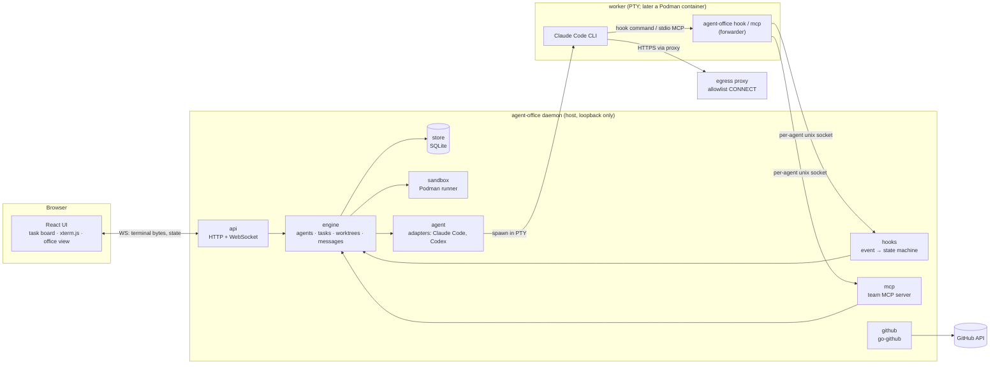
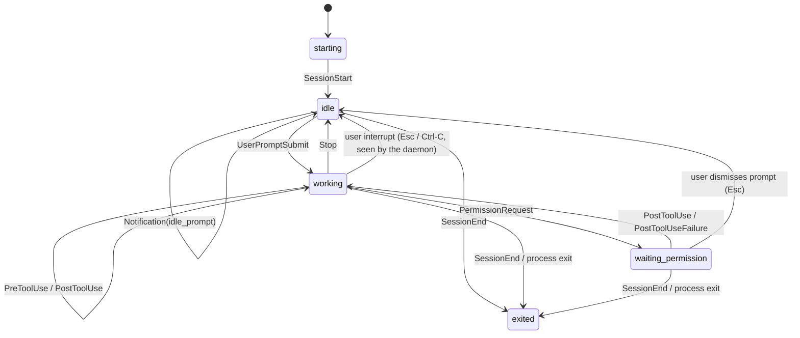

# Architecture

Status: Phase 0 design, based on the spikes in `spikes/` and the ADRs in `docs/adr/`. Parts marked
*(later)* belong to later phases and will be detailed then.

## Overview

agent-office is a single Go binary. Run as a daemon, it supervises agent CLIs (Claude Code first,
Codex later), each in its own PTY, git worktree and later its own rootless Podman container. A
browser UI talks to the daemon over HTTP and WebSocket. Agents talk to the daemon through hooks and
a team MCP server. Both go through one small forwarder, the same binary run as `agent-office hook`
or `agent-office mcp`, connected to a **per-agent unix socket**.

## Components (`internal/`)

| Package | Responsibility |
|---|---|
| `agent` | Adapter per agent CLI: command line, env, settings file, and translating CLI-specific hook payloads into common events. |
| `engine` | Owns the lifecycle of agents, tasks, worktrees and messages. All state changes go through it. |
| `hooks` | Accepts forwarded hook events from the per-agent sockets and runs the agent state machine. |
| `mcp` | Team MCP server (go-sdk): `create_task`, `assign_task`, `send_message`, `report_done`, `request_access`. *(Phase 4)* |
| `store` | SQLite via modernc + sqlc, forward-only goose migrations (ADR 0004, 0011, 0012). |
| `git` | git CLI wrapper: worktrees, branches, branch-name slugs (ADR 0009, 0010). |
| `sandbox` | Starts workers in rootless Podman with the egress proxy and secrets. *(Phase 3)* |
| `github` | PRs and reviews through go-github; never the `gh` CLI. *(Phase 5)* |
| `api` | HTTP + WebSocket for the UI; serves the embedded UI build. |

## Key flows

**Start an agent (Phase 2).** The UI asks the API to start an agent, optionally for a task. The
engine reserves a slot (`--max-agents`), creates a git worktree on a new branch
(`agent-office/<task-slug>-<id>`) under `$XDG_DATA_HOME/agent-office/worktrees/<project>/<id>`
(ADR 0010), records agent, worktree and session in SQLite (ADR 0011), and moves the task to
`in_progress`. It then creates the agent's socket `$XDG_RUNTIME_DIR/agent-office/agents/<id>.sock`
(mode 0600) and a settings file whose hooks call `agent-office hook`, and spawns
`claude --session-id <uuid> --settings <file> --model <m> -- "<task prompt>"` in a PTY inside the
worktree. The child env is scrubbed of the daemon's own `CLAUDE*` variables, and
`AGENT_OFFICE_SOCKET` points at the agent's socket.

**Remove an agent.** Only exited agents can be removed. A clean worktree is removed, and its
branch is deleted unless it has commits. A dirty worktree is kept until the user explicitly
discards it. On startup the daemon marks unfinished agents `daemon_restart`, runs
`git worktree prune` and reconciles worktree records with the disk.

**Terminal.** The PTY reader goroutine appends output to a scrollback ring and fans it out to every
attached WebSocket (binary frames). Input and resize come back as JSON text frames. Sessions
outlive browser tabs; a re-attaching tab gets the scrollback followed by live output (ADR 0002).

**Agent state.** Claude Code runs `agent-office hook`, which forwards the stdin JSON over the
agent's socket and relays the daemon's reply to stdout. Which socket a connection arrives on
identifies the agent; the payload's `session_id` must match. The `hooks` package maps events to
states (ADR 0003):

Events that carry an `agent_id` (subagents, internal background agents) update activity details
but never the main state. Claude Code sends no hook for an interrupted turn or a dismissed
permission prompt, so the daemon, which carries all terminal input, treats a lone Esc or Ctrl-C
in those states as a user interrupt.

**Message delivery (Phase 4).** If the recipient is **working**, the message is queued and returned
as `{"decision":"block","reason":"<message>"}` on its next Stop hook (unless `stop_hook_active`).
If it is **idle**, the daemon types the message into the PTY as user input. Both paths were shown
to work in Spike B.

**Isolation (Phase 3).** Each worker is a rootless Podman container on an `--internal
--disable-dns` network. Only its worktree and its own agent socket are mounted. Egress goes through
an allowlist CONNECT proxy, and secrets arrive as `podman secret` env vars (ADR 0007).

## Domain model (first draft)

| Entity | Key fields | Notes |
|---|---|---|
| **Agent** | id, name, role (lead / worker / reviewer), adapter (claude-code / codex), state, worktree_id, current_session_id | One live session at a time. |
| **Session** | id (= CLI session UUID), agent_id, started_at, ended_at, end_reason, transcript_path, cost_usd, tokens | One per CLI process; cost comes from the transcript (Phase 8). |
| **Task** | id, title, description, status (todo / assigned / in_progress / review / done / blocked), assignee_agent_id, created_by, parent_task_id | The lead creates tasks through MCP. |
| **Worktree** | id, repo_path, path, branch, base_ref, created_at, removed_at | One per worker agent. |
| **Message** | id, from_agent_id, to_agent_id, body, created_at, delivered_at, delivery (stop_hook / pty) | Delivered exactly once. |
| **AccessRequest** | id, agent_id, kind (domain / secret / path), value, reason, status, decided_by | A human approves in the UI (Phase 4). |
| **Event** | id, agent_id, session_id, kind, at, summary | Hook events, reduced to non-sensitive fields. |

## Threat model (first draft)

**Assets:** the user's host (files, SSH keys, credentials), secrets given to agents (API keys,
GitHub token), repository integrity, and the user's account and money (API spend).

**Trust boundaries:** browser ↔ daemon, daemon ↔ agent process, agent ↔ internet, daemon ↔
GitHub. Agents are treated as **untrusted**: they run model-generated code and read
attacker-controllable content (issues, web pages, dependencies) that may carry prompt injection.

| Threat | Mitigation | Phase |
|---|---|---|
| A website drives the local daemon (CSRF / cross-site WebSocket) | Bind to loopback only; WebSocket same-origin check (tested in Spike A); later an auth token for the API | 1, 10 |
| Another local process forges hook events or MCP calls | Per-agent unix socket, mode 0600, in `$XDG_RUNTIME_DIR`; check `session_id` against the socket's agent | 1, 4 |
| Agent reads host secrets (`~/.ssh`, credential stores) | Container mounts only the worktree. Claude Code's own sandbox is not enough: reads are open by default and file tools are not covered (Spike E) | 3 |
| Agent exfiltrates data over the network | Internal network with no route and no DNS; allowlist proxy, CONNECT :443 only | 3 |
| Secret leakage via the process list, `podman inspect` or logs | `podman secret` (not `-e`); never log env or hook payload contents; scrub `CLAUDE_CODE_*` from the child env | 1, 3 |
| Agent escalates its own permissions | `request_access` needs human approval; access changes are made by deterministic code, not the model | 4 |
| Runaway cost / loops | Stop-hook loop guard (`stop_hook_active`); per-agent budget and turn limits; cost tracking | 4, 8 |
| Malicious repo content runs on the host | Phases 1–2 run agents on the host with normal permission prompts (no bypass); full permissions only inside the sandbox | 1–3 |
| Agent pushes or merges unreviewed code | Agents never get merge rights; PRs are opened by the daemon, and merging stays human | 5 |
| Sensitive data in captured payloads | Store reduced events only; raw hook payloads and transcripts are never persisted or sent to the UI in full | 1, 8 |
